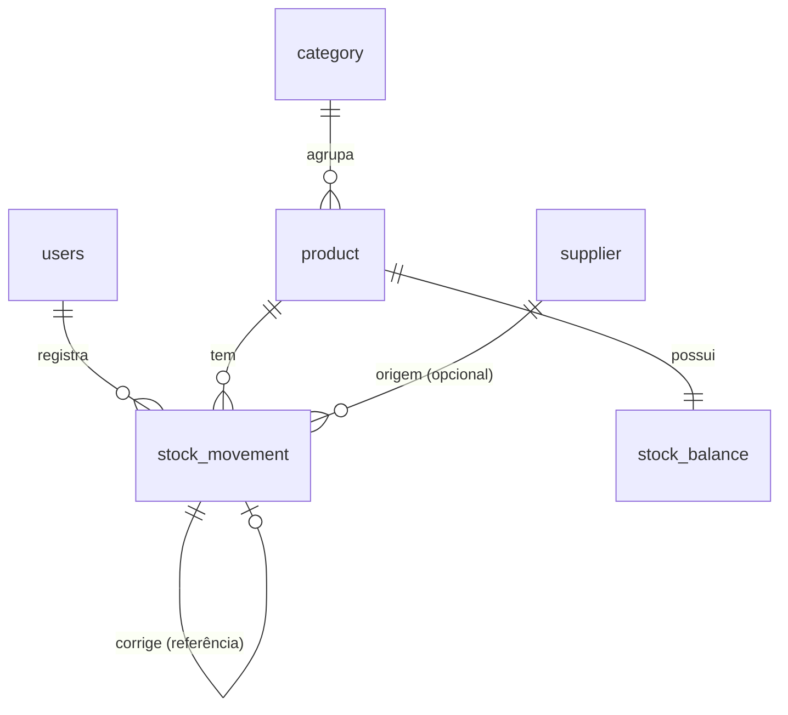

# Estoque Fácil

Controle de estoque enxuto para pequenos negócios: produtos, fornecedores, entradas, saídas, ajustes, saldo e alertas de estoque mínimo, com histórico auditável.

> Projeto demonstrativo de portfólio, com dados fictícios.

**Fluxo vertical do MVP:** login → cadastrar produto → entrada → saída → consultar saldo e histórico → alerta de mínimo.

## Stack

Java 21 + Spring Boot · PostgreSQL + Flyway · React + TypeScript · Docker Compose · GitHub Actions

## Estrutura

```
estoque-facil/
├── backend/      # API Spring Boot (monólito modular)
├── frontend/     # React + TypeScript (a criar na Sprint 0)
├── docs/         # decisões, arquitetura, modelo de dados
├── docker-compose.yml
└── .env.example
```

## Como rodar

Pré-requisitos: JDK 21, Node LTS, Docker, Git.

```bash
cp .env.example .env          # ajuste as senhas
docker compose up --build     # sobe Postgres + backend
```

- Health: http://localhost:8080/actuator/health
- Swagger: http://localhost:8080/swagger-ui.html

### Testes do backend

```bash
cd backend
mvn verify     # os testes usam Testcontainers (Docker precisa estar rodando)
```

## Modelo de dados



## Decisões

Veja [docs/decisoes.md](docs/decisoes.md).

## Status

- [x] Sprint 0: esqueleto, migration inicial, CI
- [ ] Sprint 1: login, papéis, categorias, produtos, fornecedores
- [ ] Sprint 2: movimentações e transações
- [ ] Sprint 3: saldo, alertas, dashboard
- [ ] Sprint 4: concorrência, E2E, seed, deploy demonstrativo
